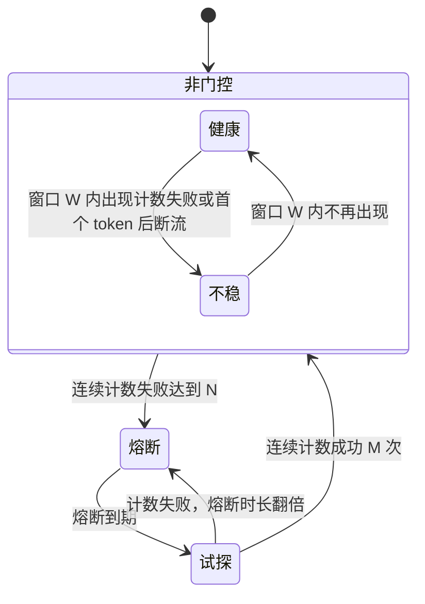

# 健康门控

> Parent: [../index.md](../index.md)
> Audience: developer — 开发和演进项目的人或 agent
> Genre: feat — 这个 feature 是什么、为什么值得、什么形态
> Visibility: public — 他人可读，避免写入本机环境
> Maintain: living — 持续更新，保持内容有效

健康门控（`health-gated`）是 fork 新增的负载均衡策略：按「渠道 × 上游实际模型」统计失败并熔断，
熔断的组合退出普通候选，全部不可用时只留一次最后一试。
会话在缓存保护窗口内留在归属渠道上，不因单次波动来回切换。
管理员依赖它看到哪个渠道×模型坏了、某次请求为何转移，并在熔断与恢复时收到通知。

文档分两部分：「选路门控」是熔断状态机与选路，「会话归属与决策记录」建立在它之上。
两部分的 D、R 编号各自从 1 开始，跨部分引用时写明部分名。

## 动机

### 选路门控

- 管理端无法直观看到哪个渠道×模型坏了。
- 上游的 `(渠道, 模型)` 熔断器只挂在 `circuit-breaker` 策略下，阈值写死，查询与重置方法无调用方
  （`internal/server/biz/model_circuit_breaker.go:144-149,359-435`）。
- 默认策略 `adaptive` 只按渠道扣分并在 5 分钟内衰减
  （`internal/server/orchestrator/lb_strategy_bp.go:43,49-90`）：
  - 坏渠道仍留在候选中。
  - 一个模型失败会拖累同渠道其他模型。
- 其他策略下粘性渠道不经健康评分（`internal/server/orchestrator/candidates.go:737-751`）。
  已坏的粘性渠道每个请求都排在最前，要先在它上面失败并用完同渠道重试，再转移到其他渠道。
- 要覆盖的场景：
  - 长期红：某渠道×模型持续失败，不应频繁成为候选。
  - 间歇红：偶发失败、长期黄绿，本次请求需要绕开，下次仍可使用。
  - 单个渠道×模型损坏时，同渠道其他模型不受影响。

### 会话归属与决策记录

- 上游的会话粘性在每次尝试前改写（`internal/server/orchestrator/request_execution.go:137-145`、
  `internal/server/biz/request.go:1353-1367`）。故障转移后又被下一次波动切回，每次切换都可能落到冷缓存、
  推高费用。
- 管理端看不到某次请求为何跳过或转移渠道。
- 熔断发生时无通知。
- 要覆盖的场景：会话不因单次波动在渠道间来回切换，也不长期停在失败渠道上。

## 形态

- D 编号是确定形态的决策，R 编号是行为规则。
- CCH 指 `ding113/claude-code-hub`，对照内容见[CCH 对照与取舍](../../reports/cch-comparison.md)。

每个 `(渠道, 上游实际模型)` 组合有四种状态，转换细则见选路门控 R1、R2。
图中的 N、M、W 是可配置参数（选路门控 R10），「计数失败」的口径见选路门控 R6。

### 选路门控

- D1 新增第五种负载均衡策略 `health-gated`（健康门控），与上游 `adaptive`、`failover`、
  `circuit-breaker`、`round-robin` 平行。
  - 可在系统重试策略、API Key profile 与模型设置中选择。
  - 上游四种策略的行为不变，以降低同步上游的冲突面。
- D2 粒度：熔断主体为 `(渠道, 上游实际模型)`，即经渠道模型映射后发往渠道上游的模型（候选项 `ActualModel`），
  不是请求模型或别名。
- D3 全部候选熔断：
  - 选熔断最早到期的一个试一次。
  - 该次为计数失败，或试探名额（同一组合同时只放行一个试探请求，见 R1）被占时，返回 503。
    错误体为通用的服务不可用文案，不暴露渠道名
    （沿用 CCH，`src/app/v1/_lib/proxy/forwarder.ts:3214-3216,8626`）。
  - 结果为「不计入」类（如 400/404/422、429）时原样返回渠道上游的错误，不改写为 503。
  - 503 仅适用于尚未向客户端提交响应的失败。流式响应头已发出后
    （`internal/server/api/chat.go:281-288`）发生的中断沿用流内错误与终止语义：不重试，
    不改写 HTTP 状态码，健康结果按 R4、R6 记录。
  - 客户端取消后不再写响应。
- D4 单机部署：健康状态只存进程内存，不做跨实例共享，重启后清零。
- D5 统计范围：只统计走 `health-gated` 策略的流量。其他策略的请求不产生、不改变健康状态，
  保证管理端看到的熔断即实际生效的熔断。
- D6 健康候选排序：
  - 模型关联优先级分组保持小值先。
  - 组内硬不可用候选后置，可用候选按渠道 OrderingWeight 大值先。
    硬不可用是负载均衡评分给出的类别（`isHardUnavailableScore`，
    `internal/server/orchestrator/load_balancer.go:294-296`），如渠道处于限流冷却，
    与健康门控的熔断无关。
  - WeightRoundRobin、LatencyAware、RateLimitAware 综合分仅在同权重内排序，
    避免旧渠道历史样本压过新增高权重渠道。
- D7 上游的 `circuit-breaker` 策略及其熔断器保留原样，不改动、不复用其实例。
- D8 额度状态交给上游的配额路由（系统默认模式加渠道级覆盖，模式为忽略额度、耗尽时移除、背压），
  本策略不为额度另设口径：
  - 选路时先按配额路由过滤候选，再做熔断判定、试探与最后一试。被配额路由移除的渠道不参与其中任何一步。
  - 额度告警不影响排序。
  - 「背压」模式下，用量偏高但未耗尽的渠道先只对已在该渠道上的会话保留。
    这样过滤后没有任何候选时，配额路由放回这些渠道，新会话也可使用，再进入门控判定。
  - 「已在该渠道上」以会话归属（会话归属与决策记录 R1）为准，不读其他策略使用的粘性缓存。
  - 过滤后没有候选时返回额度耗尽错误，不进入最后一试。

### 会话归属与决策记录

- D1 有效缓存保护窗口内不主动迁回，窗口过期后按当前健康候选与权重重新选择。
- D2 v2 归属必须有明确的有效截止时间。缺失、过期或无截止时间的记录均按新会话处理，
  不从旧 v1/previous-channel 记录恢复归属。
- D3 K（触发迁移的连续转移次数，见 R4）为系统级参数，放在重试策略的健康门控参数中，不提供渠道覆盖。
- D4 决策记录包含：
  - 请求开始时的归属渠道×模型。
  - 因熔断被跳过的渠道×模型。
  - 是否临时转移。
  - 是否最后一试。
  - 本次是否迁移：迁出、迁入与原因（归属熔断或连续 K 次转移）。
- D5 Webhook 只在首次熔断与恢复时发送。熔断期间试探失败、翻倍延长不发送。

## 行为规则

### 选路门控

- 健康状态：
  - R1 状态：健康、不稳、熔断、试探。
    - 熔断与试探是互斥且优先的门控状态。
    - 仅在非熔断、非试探时，最近窗口 W 内有计数失败或首个 token 后断流才显示为不稳，否则为健康。
    - 健康与不稳同等参与候选：不稳仅用于展示，不降权（沿用 CCH）。
    - 熔断的组合在本次选路中不参与候选，也跳过粘性优先，但不删除、不改写粘性缓存。
    - 普通试探只放行无粘性渠道的新会话，同一渠道×模型同时只放一个请求（试探名额）。
    - 「无粘性渠道」指粘性模式关闭，或本会话没有有效的归属记录（见会话归属与决策记录 D2、R1）。
      判定在 `internal/server/orchestrator/health_gate_session.go:48-84`，
      不以粘性渠道是否仍在候选中推断。
    - 有试探资格时，试探组合与健康候选按同一优先级分组和负载均衡评分正常排序，不前置也不后置。
  - R2 转换：
    - 连续计数失败达到 N 进入熔断。
    - 熔断到期进入试探。
    - 试探连续计数成功 M 次回到非门控状态，按 R1 的窗口规则显示健康或不稳。
    - 试探中计数失败则重新熔断，时长翻倍，有上限。
    - 健康或不稳下计数成功一次即清零连续失败。
    - 翻倍级数在恢复后保留，恢复后持续无计数失败超过熔断时长上限才清零。
      其间再次熔断从已达级数继续翻倍。
  - R3 计数单位：
    - 一次请求在某 `(渠道, ActualModel)` 上的尝试（含对该组合的同渠道重试）结束时记一次结果。
    - 中途失败、最终成功记为成功（沿用 CCH）。
    - 最终失败按该组合最后一次尝试的分类记录。
    - 同渠道重试可能切换到该渠道的另一个 ActualModel
      （`internal/server/orchestrator/outbound.go:848-852`），各组合分别记录。
  - R4 结果分类：计数成功、计数失败、仅不稳、不计入四类，口径见 R6。
    - 流式请求以渠道上游的终态为准，收到 HTTP 200 或首个 token 不算成功：
      - 正常完成，或因输出上限、内容过滤提前结束（Responses 协议的 `incomplete`）：计数成功。
      - 渠道上游报告取消：不计入。
      - 渠道上游报告失败，或没有终态：按 R6 的流中断处理。
    - 试探遇到「仅不稳」或「不计入」时释放试探名额，只更新最近异常信息。
      试探进度不增不减，保持试探状态等待下一个请求，不重新熔断也不延长熔断。
  - R5 无健康候选时的最后一试（D3 的细化）：
    - 经模型、权限等既有准入过滤后，若没有健康或不稳的候选，先按普通试探规则尝试取得试探名额。
    - 取不到名额时进入最后一试。取不到的情形：
      - 本请求无试探资格（已有粘性渠道）。
      - 全部组合仍处于熔断。
      - 试探名额已被占用。
    - 最后一试优先选已到期的试探组合，没有则选熔断最早到期的组合，按试探处理，计数失败按 R2 翻倍。
    - 最后一试与普通试探共用试探名额。选中组合的名额已被占用则立即返回 D3 的通用 503，
      不记健康失败。
    - 最后一试只尝试一次，不做同渠道重试。
    - 该出口不得返回模型不存在错误。空候选在既有流程里会映射为额度耗尽错误或 `ErrInvalidModel`
      （`internal/server/orchestrator/select_candidates.go:109-114`）。
- 失败口径（R6，参考 CCH `src/app/v1/_lib/proxy/errors.ts:992-1064` 并按 AxonHub 适配）：
  - 计数失败：
    - 渠道上游返回 5xx。
    - 网络错误。
    - 超时，含 408 与首事件、非流式响应超时。
    - 首个 token 前的流中断。
    - 空响应检测命中。
    - 401/403：按普通失败计数，与 CCH 一致。AxonHub 已有的自动禁用规则照常独立运作。
  - 仅不稳：首个 token 后的流中断，不计入连续失败。
  - 不计入：
    - 429。
    - 400/404/422 及其他未列出的 4xx。
    - 客户端取消。
    - 本地 RPM 与排队拒绝。
    - 熔断自身跳过，含试探名额被占。
    - 无状态码且非网络、非超时的本地错误，如请求转换失败。
  - 429 边界：429 不计入本熔断器。
    - 渠道上游带可解析的 `Retry-After` 时，沿用 AxonHub 已有的渠道冷却
      （`internal/server/orchestrator/rate_limit_tracking.go:90-102`）。
    - 无有效 `Retry-After` 时只影响本请求的故障转移，后续请求仍可正常选择该渠道。
      本功能不新增兜底冷却。
  - 与 CCH 的差异：CCH 将 429 及未命中客户端输入白名单的 400 计为供应商失败。
    AxonHub 中 429 按上一条处理，400/422 视为请求问题，均不计入。
- 可观测与管理：
  - R7 渠道列表：按渠道汇总徽章（N 个模型熔断 / N 个模型不稳），提供「只看异常」筛选。
  - R8 渠道健康详情：每个上游实际模型一行。
    - 列出状态、连续失败次数、最近错误与状态码、熔断剩余时间、下次试探时间及重置操作。
    - 查看要求 `read_channels`，重置要求 `write_channels`。
    - 重置完全清零该组合：连续失败、试探进度、翻倍级数、最近异常及各截止时间全部清除，
      回到健康，并释放试探名额。
    - 重置开启该组合的新统计周期。重置前已发出的请求照常完成业务响应，但其迟到结果不改变新周期的
      健康状态，也不得释放新周期持有的试探名额。
  - R9 统一视图：
    - 凭证自动禁用在健康详情中一并展示，机制保持独立。
    - 429 冷却不展示：其状态由各接口编排器各持一份
      （`internal/server/orchestrator/orchestrator.go:37`），合并为全局会连带改变 AxonHub 已有的 RPM/TPM 计数行为。
- 配置（R10）：
  - 系统级参数（N、首次熔断时长、上限、M、W）放入重试策略。
  - 渠道级只覆盖阈值 N，放入渠道 `settings` JSON，留空沿用系统值。
    沿用可选指针字段的惯例（`internal/objects/channel.go:222-242`）。
  - 阈值为 0 时关闭该渠道熔断：该渠道各组合既不门控也不计数，管理端显示「熔断已关闭」而非残留状态。
  - 阈值由正数改为 0 时结束原统计周期。由 0 改回正数时按空白健康状态开启新周期，
    关闭前及关闭期间发起的请求结果不回写新周期，与 R8 重置同一语义。
  - 阈值切换在该组合下一次被选路、记录结果或被管理端读取时观察并生效，不为配置变更增加跨服务通知。
  - 不为配置新增表字段。
- 生命周期（R11）：
  - 渠道停用、删除、归档或模型映射变更时不主动清理健康状态，只随时间演进或由管理员重置。
  - 条目数以实际用过的渠道×上游实际模型组合为上限，不做定期回收。
- 取消与收尾：
  - 选路、请求准入和管理端状态读取遵守调用方 context。渠道观察锁可取消等待，配置读取保持串行顺序。
  - 取消返回原 context 错误，不应用失败读取的默认配置，也不误计为渠道上游的失败。
  - 尝试健康结果登记使用独立 10 秒预算。超时只释放匹配代次与票据的自身探测占位，
    不改变新代次、其他探测或恢复进度。
- 默认值：
  - N=5。
  - 首次熔断 5 分钟，试探失败翻倍，上限 60 分钟。
  - M=2。
  - W=5 分钟。

### 会话归属与决策记录

- 会话归属：
  - R1 会话主键与保护窗口：
    - 有 thread 时，归属与连续转移计数只以 thread 缓存为权威，选路不读取、不被任何 trace 旧值覆盖。
      其他策略的选路是 trace 优先（`internal/server/orchestrator/candidates.go:772-826`）。
    - 没有 thread 时才用 trace。
    - 成功提交迁移时同步改写当前 trace 的归属，仅用于一致性与展示，不是 thread 归属生效的前提。
    - 归属保护窗口默认 5 分钟，最终出站 Anthropic 请求含合法 1 小时缓存断点时为 1 小时。
      窗口结束按新会话处理。
    - 只有原归属自身成功或实际迁移才续期。临时故障转移只更新计数，不续期旧归属。
    - 该窗口依据请求声明，不代表已确认渠道上游命中缓存。D1 不迁回只在有效窗口内保证。
    - 归属以渠道为单位。「归属渠道×模型」指归属渠道上本次请求选用的上游实际模型。
    - 仅在 `prefer_previous_channel` 粘性模式下生效，粘性关闭时不读写归属。
  - R2 归属只在请求成功时写入，失败尝试不改写。
    - 流式请求以生成完成为准。渠道上游给出未完成终态（输出上限、内容过滤）时请求记为失败，
      归属、保护窗口与转移计数不变，健康结果仍按选路门控 R4 计数成功。
    - 提交时以会话当前归属为准重新计算，按会话主键进程内串行。
    - 归属新建或迁移时建立 Generation，正常续期保持不变。
    - 完成回调校验所选世代，旧请求不得改变新归属，即使过期后重新选择的是同一渠道。
    - 多实例共享缓存时不保证跨实例串行。
  - R3 单次故障转移：由备用渠道完成本次请求，归属不变且不续期。
    下个请求仅在保护窗口仍有效时回归属渠道，过期后重新选择。
  - R4 迁移：
    - 条件，满足其一：
      - 本次请求结束时归属渠道×模型处于熔断或试探（未获本次准入，含本次请求自身触发的熔断）。
      - 同一会话连续 K 次请求都需故障转移才完成。归属渠道不在本次候选中也按故障转移计数。
    - 迁往完成该次请求的渠道，计数清零。
    - 归属渠道直接成功时连续转移计数清零。
    - 请求整体失败或客户端取消时计数不变。
  - R5 迁移后不迁回（D1）。
  - R6 归属渠道×模型已熔断时不参与粘性优先及同渠道重试，但仍可按选路门控 R5 成为最后一试。
- 归属存储与收尾：
  - 配置两级缓存且有 Redis 时，归属直接以 Redis 为权威读写，不经过异步 L2→L1 回填，
    避免旧值覆盖新归属。
  - 未配置 Redis 时使用内存。
  - 逻辑有效期以 ExpiresAt 为准。物理缓存额外保留 30 分钟有限宽限期用于迟到结果判断，不延长黏性。
  - 会话、路由记录登记使用独立 10 秒预算，包含可取消的会话锁等待。
  - 其他策略的缓存模式不变。
- 决策记录与通知：
  - R7 请求决策记录：
    - 请求表有一个可空 JSON 字段，内容见 D4，请求详情页展示。
    - 仅 `health-gated` 请求写入，请求结束（非流式完成或失败、流式关闭）时写一次。
    - 渠道名称按选路时快照保存。归属渠道不在候选中时按当时的渠道记录补齐。
  - R8 Webhook：
    - 事件为渠道×模型熔断（`channel.health_gate_opened`）与恢复（`channel.health_gate_recovered`）。
    - 复用 AxonHub 已有的通知器，按事件名匹配订阅（`internal/server/biz/webhook_notifier.go:158-238`）。
    - 异步发送，不在健康状态锁内调用。
    - 系统 Webhook 设置界面提供这两个事件选项。
    - 事件为进程内转移，多实例不去重。
- 默认值：
  - K=2（`owner_failover_threshold`，≤0 归一为 2）。

## 边界

- 不改变上游四种策略的行为。会话归属仅在 `health-gated` 策略下生效，其他策略保持上游粘性语义。
- 不引入跨实例共享或健康状态持久化。
- 不向渠道上游发合成探测请求，试探只用真实业务请求：普通试探仅放行无粘性渠道的请求，
  选路门控 R5 的最后一试除外。
- 不替代 429 冷却与自动禁用。
- 不稳状态不降权。

## 链接

- [CCH 对照与取舍](../../reports/cch-comparison.md)：失败口径、全部不可用的返回、管理端展示、
  会话绑定与决策记录的对照。
- 用户文档：[负载均衡](../../zh/guides/load-balance.md)。

## 实现与维护

### 选路门控

- 提交：
  - `6298a0cb`、`328cb528`、`dd5e17d3`
  - `eaef7c06`（合入上游 `v1.0.0-beta11` 时接入配额路由与流终态）
  - `8c8b9a6b`（透传流式中断计入健康门控）
  - `bfe76e5f`（透传下渠道上游的失败终态计入健康门控）
- 代码，新文件（新策略与健康状态不改上游熔断实现）：
  - `internal/server/biz/health_gate.go`：状态机。
  - `internal/server/biz/system_health_gate.go`：配置。
  - `internal/server/orchestrator/health_gate_{selector,middleware,outcome,errors,load_balancer}.go`
  - `internal/server/gql/channel_health_gate{.graphql,.go,.resolvers.go}`
  - `frontend/src/features/channels/components/channels-health-gate-dialog.tsx`
- 代码，上游文件只做追加式接入：
  - `internal/objects/routing.go`
  - `internal/objects/channel.go`：渠道阈值字段。
  - `internal/server/biz/system.go`：策略常量、`RetryPolicy.HealthGate`、归一化调用。
  - `internal/server/biz/channel.go`：状态字段。
  - `internal/server/biz/channel_query.go`：筛选入参。
  - `internal/server/orchestrator/orchestrator.go`：负载均衡器、中间件、`finalize` 改写最后一试错误。
  - `internal/server/orchestrator/candidates.go`：选路钩子。
  - `internal/server/orchestrator/health_gate_selector.go` 调用上游的 `QuotaRoutingGate`
    （`internal/server/orchestrator/candidates_quota.go`）过滤候选。
  - `internal/server/orchestrator/load_balancer.go`
  - `internal/server/orchestrator/outbound.go`：最后一试不做同渠道重试。
  - `internal/server/gql/` 的 `system.graphql`、`axonhub.graphql`、`gqlgen.yml`、
    `axonhub.resolvers.go`（`QueryChannels` 一行筛选钩子）与生成文件。
  - 前端策略下拉：
    - `frontend/src/features/system/components/retry-settings.tsx`
    - `frontend/src/features/apikeys/components/apikeys-*-dialog.tsx`
    - `frontend/src/features/models/components/models-association-dialog.tsx`
    - `frontend/src/features/models/data/schema.ts`
  - `frontend/src/features/channels/`
  - `frontend/src/locales/`
- 用户文档：`docs/{zh,en}/guides/load-balance.md`。
- 迁移：无 schema migration 或 data migration。
  - 重试策略新增可选 `health_gate` 对象。
  - 渠道 `settings` 新增可选 `healthGateFailureThreshold`。
  - 旧数据缺省走系统默认。
- 测试：
  - `internal/server/biz/health_gate_test.go`：状态机、翻倍与清零、代次失效、阈值 0 切换、归一化。
  - `internal/server/orchestrator/health_gate_outcome_test.go`：失败口径边界。
  - `health_gate_selector_test.go`：门控、粘性跳过、试探资格、最后一试选择。
  - `health_gate_orchestrator_test.go`：端到端熔断、503 与透传、流式首 token 后断流。
  - `internal/server/gql/channel_health_gate_test.go`：状态映射与计数。
  - `health_gate_context_test.go`：取消、配置代次与探测释放、请求 context 已取消时的上游中断与失败终态、
    透传下客户端断开不计入、透传下后台关闭晚于请求结束时归属仍写入。
  - `health_gate_load_balancer_weight_test.go`：新增高权重渠道、硬不可用候选后置、同权重分配、
    额度耗尽的渠道被移除、额度告警不改变排序、调试与生产排序一致及其他策略不变。
  - 真实 SQLite 连接池占满时，配置读取按 120ms deadline 退出，同渠道另一请求按 20ms deadline 退出锁等待。
  - 相同新会话测试使用旧排序时选 10、当前实现选 15。
  - biz、orchestrator、gql 完整测试及健康门控三轮 race 检查通过。
  - 无新增 fixture。
- 同步上游：
  - 策略枚举与前端策略下拉为追加式冲突点。
  - 上游新增策略、改动负载均衡组装或自行实现熔断可视化时，逐条对照 D1–D8、R1–R11。
  - 上游改动配额路由的过滤入口或粘性渠道的取值时，对照 D8。

### 会话归属与决策记录

- 提交：
  - `a4ffb86d`、`328cb528`、`dd5e17d3`
  - `eaef7c06`（合入上游 `v1.0.0-beta11` 时配额路由的背压接入会话归属）
  - `3e40e21a`（未完成终态不写入会话归属）
  - `989da875`（归属渠道随上游按重试策略重试）
  - `bfe76e5f`（透传下已完成的流式请求写入会话归属）
- 代码，新文件：
  - `internal/server/biz/session_owner.go`：归属缓存读写、决策持久化。
  - `internal/server/biz/health_gate_notify.go`：熔断转移异步通知。
  - `internal/server/orchestrator/health_gate_session.go`：归属判定与决策提交。
  - `internal/objects/request_routing.go`：决策记录类型。
  - `internal/server/gql/request_routing.graphql`
  - `internal/server/orchestrator/session_owner_ttl.go`：最终出站声明的保护期。
- 代码，选路门控文件的扩展：
  - `internal/server/biz/health_gate.go`：转移回调，锁外调用。
  - `internal/server/biz/system_health_gate.go`：K。
  - `internal/server/orchestrator/health_gate_selector.go`：thread 优先归属、跳过项与最后一试快照。
  - `internal/server/orchestrator/health_gate_middleware.go`：成功时提交。
- 代码，上游文件只做追加：
  - `internal/server/orchestrator/outbound.go`：保存最终传输请求对象。
  - `internal/server/biz/request.go`：归属缓存字段。
  - `internal/server/biz/webhook_notifier.go`：两个事件、`.Model.ActualModel` 与 `.Trigger.OpenUntil` 模板变量。
  - `internal/ent/schema/request.go`：字段。
  - `internal/server/orchestrator/request_execution.go`：`health-gated` 下尝试前不写粘性缓存。
  - `internal/server/orchestrator/orchestrator.go`：每个 Process 的决策槽位。
  - `internal/server/gql/system.graphql`、`internal/server/gql/gqlgen.yml` 与 ent、gqlgen 生成物。
  - `frontend/src/features/requests/`：路由决策卡片。
  - `frontend/src/features/system/components/{retry-settings,webhook-settings}.tsx`
  - `frontend/src/features/system/data/system.ts`
  - `frontend/src/locales/`
- 用户文档：`docs/{zh,en}/guides/load-balance.md`。
- 迁移：
  - 请求表新增可空 JSON 列 `routing_decision`，由 ent 自动迁移，无 data migration。
  - 归属缓存键为 `axonhub:routing:session-owner:v2:{thread|trace}:%d`，包含 ExpiresAt 与 Generation。
  - 不读取缺乏可证明有效期的 v1/previous-channel 记录。首次升级后原会话重新选路一次，
    避免继承已无缓存收益的旧黏性。
  - 旧 `previous-channel:v1` 保持整数值形状，供其他策略使用，不作为健康门控恢复归属的来源。
- 测试：
  - `internal/server/biz/session_owner_test.go`：thread 权威、过期与旧值拒绝、显式截止时间、
    活跃续期与临时转移不续期、缓存读错误、决策读写。
  - `internal/server/biz/health_gate_test.go`：只在首次熔断与恢复产生转移、回调锁外可重入。
  - `internal/server/biz/health_gate_notify_test.go`：事件订阅匹配、渲染字段、异步桥接。
  - `internal/server/orchestrator/health_gate_session_test.go`：单次转移保留归属、连续 K 次迁移、
    归属熔断立即迁移、归属成功清零、失败与取消不写、流式仅完成后提交、粘性关闭不读写、
    配额路由的背压以会话归属为准。
  - `internal/server/orchestrator/health_gate_selector_test.go`：跳过项、最后一试剔除、归属优先。
  - `health_gate_product_test.go`：
    - 只有渠道 10 → 新增 15 → 新 thread 选 15，有效旧会话仍选 10。
    - 空闲 6 分钟或 31 分钟后选 15。
    - 合法 1 小时声明仍有效时保持 10。
  - `session_owner_ttl_test.go`：最终出站断点及覆盖操作。
  - 另覆盖临时转移不续期、旧请求迟到不改变新世代、旧键不继承及两级配置下 Redis 权威读写。
  - 空闲用绝对截止时间推进，旧 30 分钟物理过期用 Redis 模拟时钟验证。
  - 三包完整测试及归属三轮 race 检查通过。
  - 无新增 fixture。
- 同步上游：
  - `request_execution.go`、`candidates.go`、`biz/request.go` 中按策略分支改变粘性写入时机，为冲突高发点。
  - 上游改动粘性缓存或请求表结构时，逐条对照 R1–R8。
